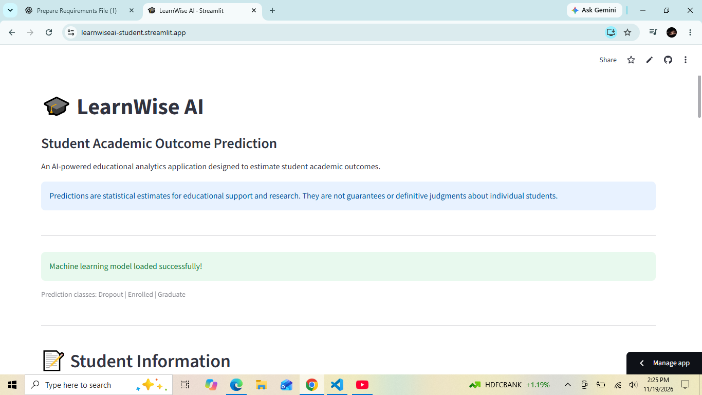
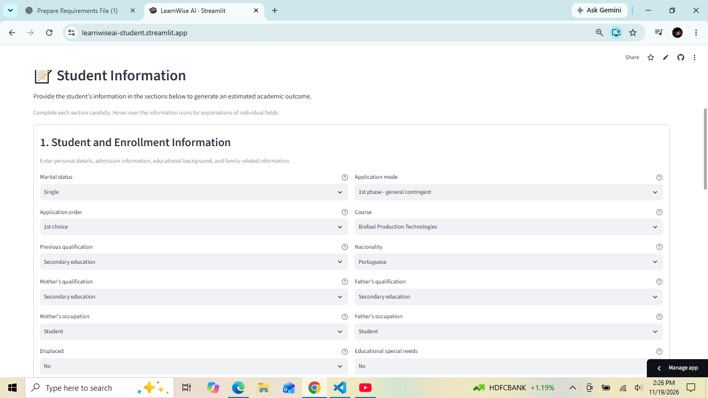
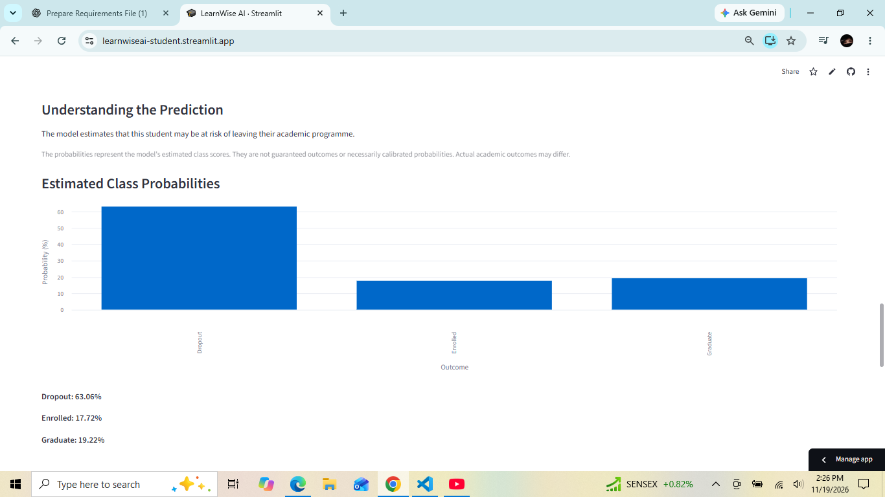
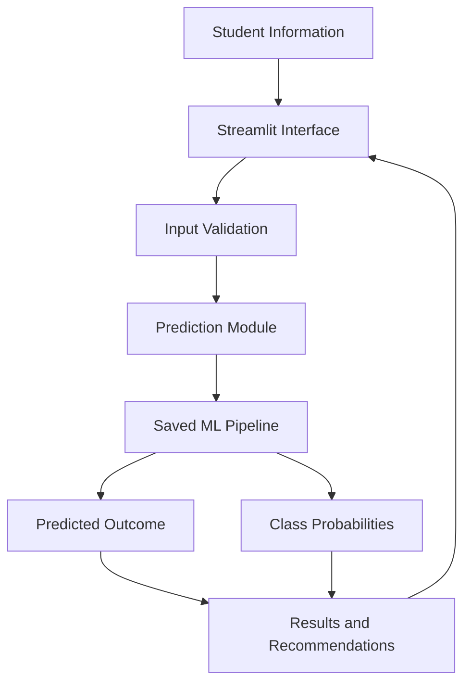

# 🎓 LearnWise AI
### Student Academic Outcome Prediction Using Machine Learning

[](https://www.python.org/)
[](https://scikit-learn.org/)
[](https://streamlit.io/)
[](https://learnwiseai-student.streamlit.app/)

**LearnWise AI** is a machine learning-powered educational analytics application that estimates student academic outcomes based on demographic, academic, enrollment-related, and socioeconomic information.

The application predicts one of three possible outcomes:

- 🎓 **Graduate** — Expected successful completion of the academic programme.
- ⚠️ **Dropout** — Predicted discontinuation of the academic programme.
- 📚 **Enrolled** — Predicted continuation of enrollment.

The goal is to demonstrate how machine learning can be used in educational analytics to identify patterns in historical student data and potentially help institutions identify students who may benefit from additional academic support.

---

## 🌐 Live Demo

**Try the deployed application:**

👉 [Launch LearnWise AI](https://learnwiseai-student.streamlit.app/)

---

## 🎯 Problem Statement

Educational institutions may have thousands of student records containing academic performance, enrollment details, demographic information, and socioeconomic indicators.

Analyzing this information manually can make it difficult to identify patterns associated with different academic outcomes.

LearnWise AI applies a trained machine learning classification pipeline to student information and estimates the probability of each outcome. These predictions can serve as an analytical aid for understanding student outcome patterns and exploring potential support needs.

> The application is a portfolio proof of concept. Its predictions are not intended to replace institutional expertise, individual student assessment, or human decision-making.

---

## ✨ Features

- **Student Academic Outcome Prediction** — Predicts Graduate, Dropout, or Enrolled.
- **Three-Class Classification** — Supports three academic outcome categories.
- **Probability Visualization** — Displays estimated probabilities for each predicted class.
- **Interactive Web Interface** — User-friendly Streamlit application.
- **Categorical Input Labels** — Human-readable labels for student information.
- **Input Validation** — Checks logically inconsistent academic inputs.
- **Prediction Explanation** — Provides contextual information about the prediction.
- **Academic Support Suggestions** — Offers recommendations based on the prediction.
- **Student Information Summary** — Summarizes submitted student information.
- **Model Transparency** — Displays model evaluation and relevant information.
- **Error Handling** — Includes validation and user-friendly error handling.

---

## 🖥️ Application Preview

### Main Application



### Student Information Form



### Prediction Results




## 🛠️ Tech Stack

| Technology | Purpose |
|---|---|
| Python | Core programming language |
| Pandas | Data manipulation and preprocessing |
| NumPy | Numerical operations |
| Scikit-learn | Machine learning and preprocessing pipeline |
| Joblib | Model serialization and loading |
| Streamlit | Interactive web application |
| Matplotlib | Data visualization |
| Seaborn | Exploratory data analysis and visualization |
| Git | Version control |
| GitHub | Source code hosting |
| Streamlit Community Cloud | Application deployment |

---

## 📊 Dataset

This project uses the **Predict Students' Dropout and Academic Success** dataset from the UCI Machine Learning Repository.

### Dataset Overview

| Property | Value |
|---|---|
| Records | 4,424 students |
| Original features | 37 columns |
| Prediction task | Multi-class classification |
| Target classes | Graduate, Dropout, Enrolled |
| Data type | Demographic, academic, enrollment, and socioeconomic information |

### Target Variable

The target variable is `Target`, containing three classes:

- `Graduate`
- `Dropout`
- `Enrolled`

### Dataset Source & Attribution

Realinho, V., Vieira Martins, M., Machado, J., & Baptista, L. (2021).

*Predict Students' Dropout and Academic Success* [Dataset].

UCI Machine Learning Repository.

- Dataset: https://archive.ics.uci.edu/dataset/697/predict
- DOI: https://doi.org/10.24432/C5MC89
- License: CC BY 4.0

---

## 🤖 Machine Learning Workflow

The project follows an end-to-end machine learning workflow:

1. **Data Understanding** — Explore the dataset and understand feature types and target distribution.
2. **Exploratory Data Analysis** — Analyze patterns, distributions, relationships, and class imbalance.
3. **Data Preprocessing** — Prepare categorical and numerical features for model training.
4. **Feature Processing** — Apply appropriate transformations through the machine learning pipeline.
5. **Model Training** — Train a classification model using historical student records.
6. **Model Evaluation** — Evaluate performance on held-out test data.
7. **Model Serialization** — Save the trained pipeline using Joblib.
8. **Application Integration** — Load the trained pipeline into the Streamlit application.
9. **Prediction** — Generate outcome predictions and estimated class probabilities for user inputs.
10. **Deployment** — Deploy the application through Streamlit Community Cloud.

---

## 🏗️ Application Architecture



### Project Components

- **Streamlit UI:** Collects student information and displays results.
- **Input Configuration:** Defines numerical and categorical input features and their labels.
- **Prediction Module:** Loads the trained model and generates predictions.
- **Model Pipeline:** Performs the configured preprocessing and classification steps.
- **Results Interface:** Displays the prediction, estimated probabilities, explanations, and recommendations.

---

## 📈 Model Performance

The trained model was evaluated on a held-out test set.

| Metric | Score |
|---|---:|
| Test Accuracy | **70.96%** |
| Macro F1-Score | **66.11%** |

### What These Metrics Mean

- **Accuracy** measures the proportion of all test predictions that were correct.
- **Macro F1-Score** calculates the F1-score for each class and averages them equally, making it useful when class distributions are imbalanced.

These metrics represent the model's performance on the evaluated test dataset. They do not guarantee the same performance on students from other institutions or populations.

---

## 📁 Project Structure

```text
LearnWise-AI/
│
├── app/
│   ├── __init__.py
│   ├── main.py
│   ├── predictor.py
│   ├── category_labels.py
│   └── feature_config.json
│
├── data/
│   └── raw/
│       └── data.csv
│
├── models/
│   └── learnwise_model.joblib
│
├── notebooks/
│   └── 01_exploratory_data_analysis.ipynb
│
├── .gitignore
├── README.md
└── requirements.txt
```

---

## ⚙️ Installation & Local Setup

### Prerequisites

- Python installed
- Git installed

### 1. Clone the repository

```bash
git clone https://github.com/Akash-295/Learnwise_AI.git
```

### 2. Navigate to the project directory

```bash
cd Learnwise_AI
```

### 3. Create a virtual environment

```bash
python -m venv .venv
```

### 4. Activate the virtual environment

**Windows PowerShell:**

```powershell
.venv\Scripts\Activate.ps1
```

### 5. Install dependencies

```bash
python -m pip install -r requirements.txt
```

### 6. Run the application

```bash
python -m streamlit run app/main.py
```

The application will open in your browser, usually at:

http://localhost:8501

---

## 📖 How to Use

1. Open the LearnWise AI application.
2. Enter the student's demographic and enrollment information.
3. Select the attendance schedule.
4. Enter academic performance and socioeconomic information.
5. Submit the student information.
6. View the predicted academic outcome.
7. Explore estimated probabilities for all three classes.
8. Review the prediction explanation and academic support recommendations.

---

## ⚠️ Limitations & Responsible Use

LearnWise AI is an educational machine learning proof of concept and should be used responsibly.

- Predictions are estimates, not guaranteed academic outcomes.
- The model learns patterns from historical data and does not establish causation.
- Performance may differ when applied to other institutions, countries, or student populations.
- Estimated probabilities should not automatically be interpreted as calibrated individual risk.
- Historical data may contain biases that affect model predictions.
- Predictions should not be used as the sole basis for admission, disciplinary, academic, or administrative decisions.
- Student privacy and data protection must be considered when handling real student information.
- Human judgment and the individual circumstances of students must always be considered.

The intended use is exploratory educational analytics and potentially identifying students who could benefit from supportive intervention—not penalizing or labeling students.

---

## 🚀 Future Improvements

Potential future enhancements include:

- Detailed class-wise precision, recall, and F1-score analysis
- Confusion matrix and error analysis
- Feature importance and model interpretability
- Probability calibration evaluation
- Model comparison and tuning
- More comprehensive automated testing
- Improved prediction explanations
- Expanded responsible AI and bias evaluation
- Monitoring model performance on new data

---

## 👨‍💻 Author

**Akash**

BCA Student | Machine Learning Learner

GitHub: [@Akash-295](https://github.com/Akash-295)

---

## 📌 Project Status

LearnWise AI is currently deployed and functional.

The application has been tested locally and on its deployed environment.

---

*LearnWise AI — Turning Educational Data into Meaningful Insights.*
